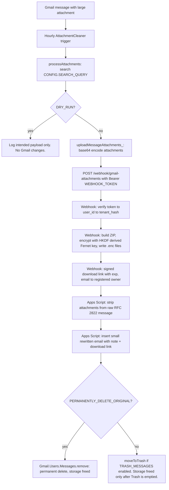
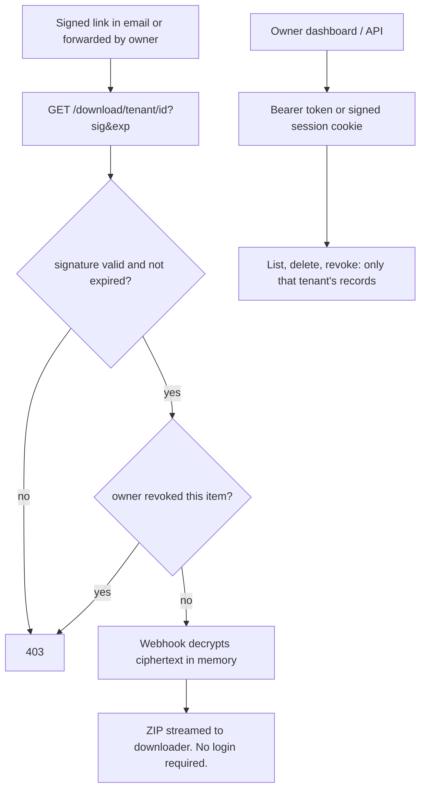
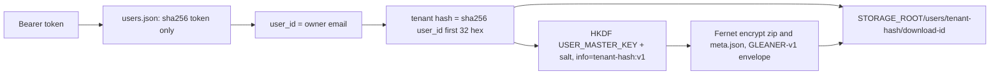

# Flow diagrams

## Gleaner: freeing Gmail storage



Download and management are deliberately different surfaces:



Tenant isolation and encryption:



The browser never decrypts: the web UI (`/login` → `/` dashboard → `/admin`) is a
manage-and-download surface only. Listing, revoking and deleting are
CSRF-protected owner actions; the public download endpoint stays a direct ZIP
response so forwarded capability links are one click for the receiver.

## FollowUpReminder

```text
AWV mail → FollowUp/Active label → weekly checkDigests/checkEscalations
         → collectPending → digest or escalation → label FollowUp/Escalated
```

## LabelReminder

```text
remind-every/{N}{unit} label → every 6h checkReminders
  → autoPauseOnReply (on-hold when recipient replied)
  → interval elapsed? → AI-generated threaded reminder
```

## Timing

| Job | Schedule |
|---|---|
| `AttachmentCleaner.processAttachments` | hourly |
| `LabelReminder.checkReminders` | every 6h |
| `FollowUpReminder.checkDigests` | weekly Tue 08:00 |
| `FollowUpReminder.checkEscalations` | weekly Thu 09:00 |
| `FollowUpReminder.syncLabels` | daily 06:00 |
